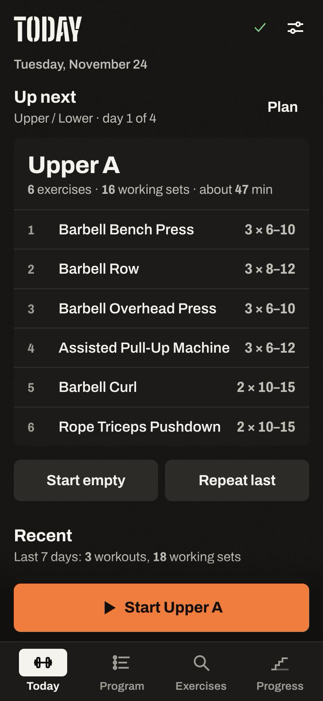
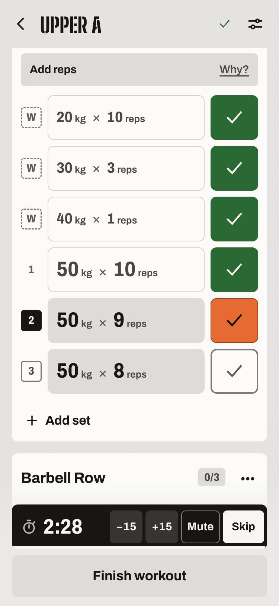
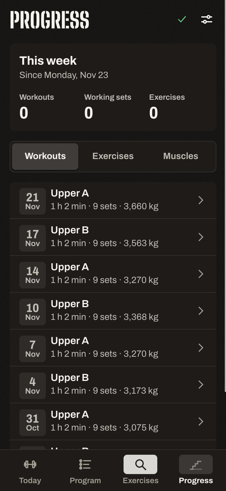
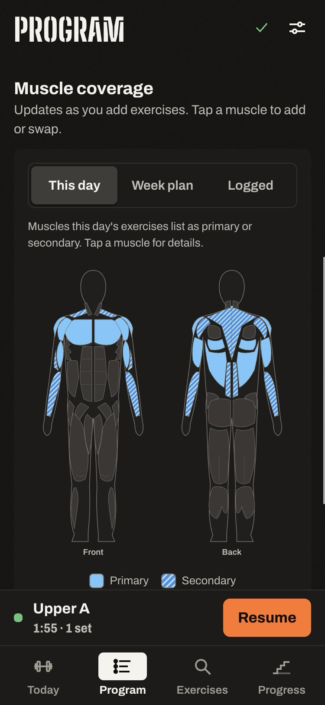

# Setstamp

A free lifting log that works offline.

Live at **https://koala3353.github.io/setstamp/**. Open it in a phone browser, create an account, and add it to your home screen.

<p>
  
  
  
  
</p>

## Features

- Logging works with no signal. Sets save to the phone first and sync when you're back online.
- Weight and reps are prefilled from last time, with large steppers you can use one-handed. Logging a set starts the rest timer.
- 1,383 exercises. Search runs on the device and handles typos and common nicknames. You can add your own exercises.
- Programs from templates (upper/lower, push/pull/legs, full body) or built day by day. A missed session stays next in line.
- Progress: personal records, estimated 1RM (labelled as an estimate) and a body map of weekly sets per muscle.
- Export everything as JSON or CSV. Deleting your account deletes your data.
- No paid tier and no limits on history or programs.
- Installable as a PWA from the browser, no app store needed.

## Tech stack

- [Vite](https://vite.dev) 8, [React](https://react.dev) 19 and TypeScript
- [Tailwind CSS](https://tailwindcss.com) 4 plus hand-written CSS tokens (see `DESIGN.md`)
- [vite-plugin-pwa](https://vite-pwa-org.netlify.app) (Workbox) for the service worker and manifest
- [Convex](https://convex.dev) for the backend and [Convex Auth](https://labs.convex.dev/auth) for email/password and Google sign-in
- IndexedDB (via [idb](https://github.com/jakearchibald/idb)) as the on-device store
- [Vitest](https://vitest.dev) with `fake-indexeddb` and `convex-test`

## How offline sync works

IndexedDB is the app's source of truth. Every write goes to the local store and to a durable outbox in the same step, so the screen updates immediately whether or not there is a connection. When the device is online, the outbox pushes batches of operations to Convex and pulls changes since the last sequence number it saw.

Each row has a client-generated ID. Writes are idempotent upserts with last-writer-wins on `updatedAt`, and deletes are tombstones. The server stamps every accepted write with a per-user sequence number so a pull never misses a row. The contract is in `src/shared/sync.ts`; the client is in `src/sync/` and the server side in `convex/sync.ts`.

## Local development

You need Node 24 (the lockfile is from npm 11) and a free Convex account.

```sh
npm install
npx convex dev      # creates a dev deployment, writes .env.local, and watches convex/
npm run dev         # in a second terminal: Vite on http://localhost:5173
```

### Environment variables

Client (`.env.local`, written by `npx convex dev`):

- `VITE_CONVEX_URL`: the Convex deployment URL
- `VITE_BASE`: optional public path, `/` by default (CI sets `/setstamp/`)

Convex deployment (set with `npx convex env set NAME value`):

- `AUTH_GOOGLE_ID`, `AUTH_GOOGLE_SECRET`: Google OAuth client. Both are required; set them to `unset` to turn Google sign-in off.
- `SITE_URL`: frontend origin used in emailed links and OAuth redirects
- `AUTH_EXTRA_ORIGINS`: optional, comma-separated extra redirect origins
- `MAIL_WEBHOOK_URL`, `MAIL_WEBHOOK_SECRET`: the email relay (below)
- `MAIL_DEV_LOG`: optional, `1` on dev logs emails instead of sending them

### Exercise catalog

The catalog is built from pinned upstream sources plus `catalog/curated.ts`, then imported into Convex:

```sh
node --experimental-strip-types scripts/build-catalog.ts          # writes catalog/catalog.generated.json
node --experimental-strip-types scripts/import-catalog.ts         # dev deployment
node --experimental-strip-types scripts/import-catalog.ts --prod  # production
```

`catalog/catalog.generated.json` is git-ignored because it contains RepDB data, and RepDB's terms don't allow republishing the dataset. Run the build script to create it locally.

### Email relay

Password reset and verification emails go through a small Google Apps Script web app in `apps-script/Code.gs`. Setup steps are in the comment at the top of that file: add `MAIL_SECRET` as a script property, deploy it as a web app, then set `MAIL_WEBHOOK_URL` and `MAIL_WEBHOOK_SECRET` on the Convex deployment.

## Testing

```sh
npx tsc -b        # type check
npx vitest run    # unit and backend tests
```

## Deploying

- Frontend: every push to `main` runs `.github/workflows/pages.yml`, which builds with `VITE_BASE=/setstamp/` and publishes `dist/` to GitHub Pages. The build also copies the app shell to `404.html` so deep links still load the app.
- Backend: `npx convex deploy` pushes `convex/` to the production deployment. Import the catalog with `--prod` after a catalog change.

## Data credits

- Exercise data by [RepDB (repdb.co)](https://repdb.co).
- Base catalog from [free-exercise-db](https://github.com/yuhonas/free-exercise-db), released under the Unlicense. Exercise images are loaded from that repository.

## Privacy

What the app stores and how to export or delete it: [privacy page](https://koala3353.github.io/setstamp/privacy.html) (source in `public/privacy.html`).

## License

No license yet. The code is public to read, but no license has been chosen, so default copyright applies.
